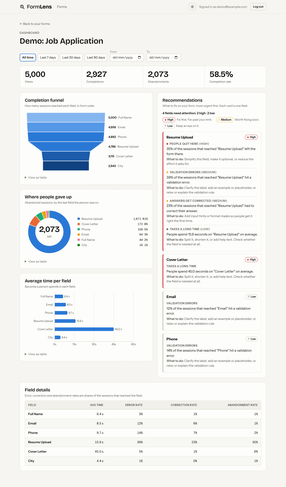
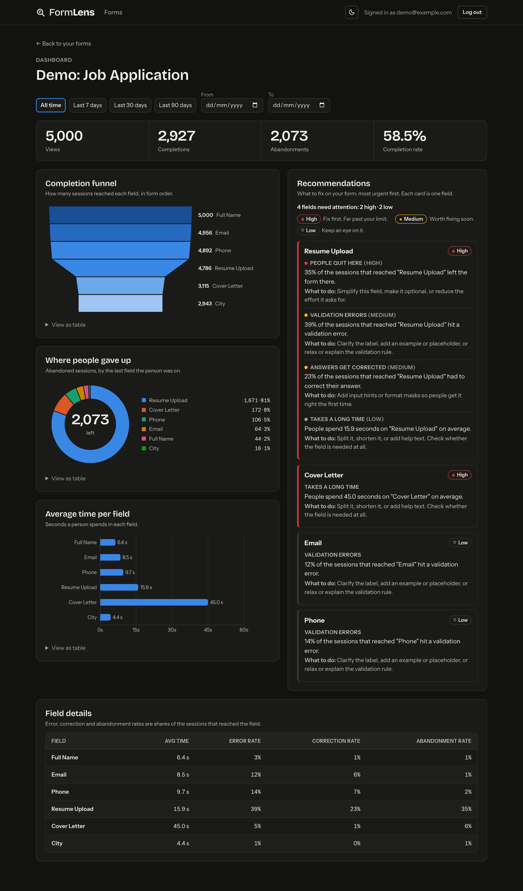
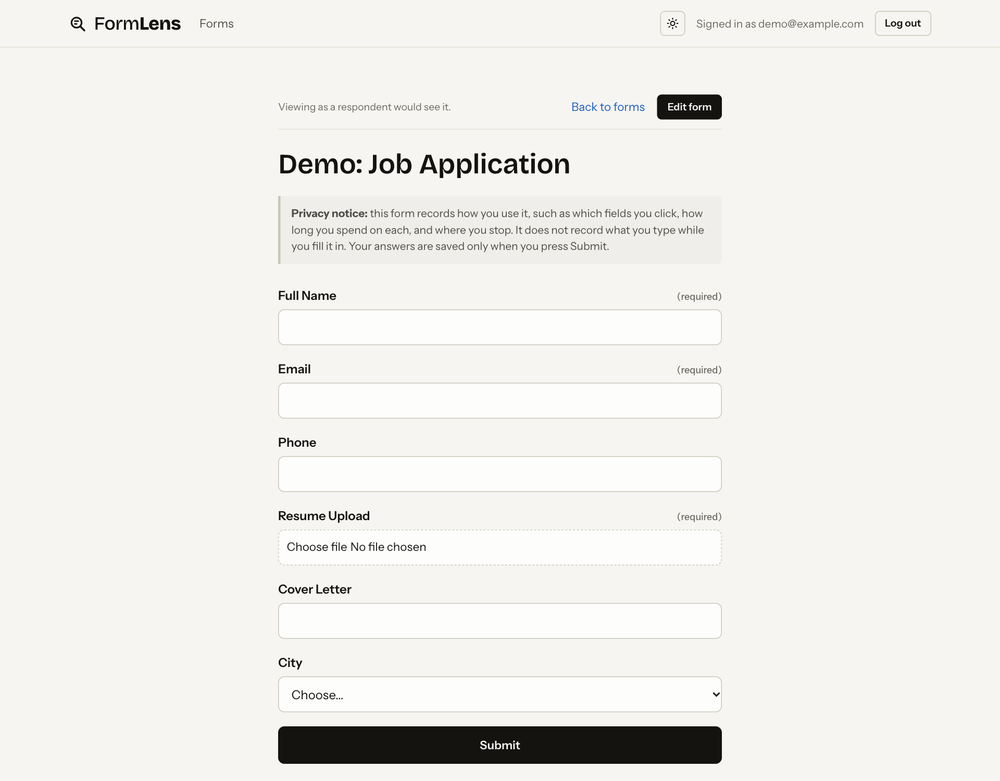
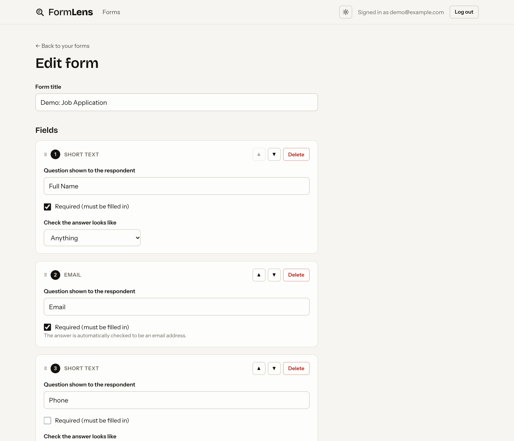
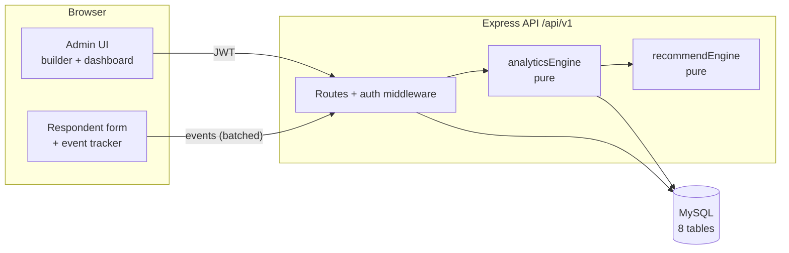

<div align="center">

# FormLens

**Find out which field of your form makes people stop, struggle or leave.**

A full-stack form builder with built-in usability analytics. Respondents fill in a form; FormLens records *how* they use it, never *what* they type, and turns that into a funnel, charts and plain-language fixes.




</div>

> Project code name: DFUA (Digital Form Usability Analyzer).

## What it does

1. An **admin** logs in, builds a form (text, email, number, dropdown, file upload), and publishes it to get a public share link.
2. **Respondents** open the link, no account needed, and fill the form. A tiny tracker records which field they focused, for how long, validation errors, corrections and where they quit.
3. The **dashboard** shows views, completions, abandonment, a field-by-field funnel, time per field and a ranked list of **recommendations**, for example *"35% of the sessions that reached Resume Upload left the form there. Simplify the field, make it optional, or reduce the effort it asks for."*

| Dashboard (dark) | Respondent view | Form builder |
|---|---|---|
|  |  |  |

## Highlights

- **Privacy by design.** Events carry ids, timings and error codes, never typed text. The server enforces this with an allow-list on event metadata. Visitor IPs are stored only as salted hashes, and old events can be purged after a retention period. The form tells respondents what is recorded.
- **Reliable event pipeline.** The tracker batches events, retries on network errors and uses client-made event ids so a retried batch is never counted twice. A load-test script fires 50 simultaneous respondents and checks that no event is lost or duplicated.
- **Pure, tested analytics.** The analytics and recommendation engines are plain modules with no Express code in them; the database connection is passed in. Rules and thresholds (abandonment, errors, corrections, time) are configurable through environment variables.
- **Validation twice.** Email, number, a 10-digit phone format, dropdown options and file size are checked live in the browser and checked again on the server.
- **Safe editing.** Admins can edit a form at any time. Removing a field that already has data archives it, so history and form totals stay intact.
- **Security basics done properly.** bcrypt (cost 12) password hashes, JWT auth, ownership checks in server middleware (another admin's form is a 404), parameterised SQL only, and a startup check that refuses placeholder secrets.
- **Accessible, themeable UI.** Visible labels, text errors linked with `aria-describedby`, keyboard-only use, a table view behind every chart, a colour-blind-checked chart palette, and a light/dark toggle that follows the system by default.

## Architecture



## Tech stack

| Layer | Tools |
|---|---|
| Frontend | React 19, Vite, Tailwind CSS v4, React Router, Recharts, Axios |
| Backend | Node.js, Express 5, mysql2, JSON Web Tokens, bcrypt, Multer |
| Database | MySQL 8 (UUID keys, UTC timestamps, 8 tables) |
| Testing | Vitest, supertest, Testing Library (jsdom) |

## Quick start

Requires Node.js 20+ and MySQL 8.

1. **Create the database and a dedicated user** (not root):
   ```sql
   CREATE DATABASE dfua CHARACTER SET utf8mb4 COLLATE utf8mb4_unicode_ci;
   CREATE USER 'dfua_user'@'localhost' IDENTIFIED BY 'choose-a-password';
   GRANT ALL PRIVILEGES ON dfua.* TO 'dfua_user'@'localhost';
   ```
2. **Configure:** `cp .env.example .env`, then set `DB_PASSWORD`, `JWT_SECRET` (32+ random characters, e.g. `openssl rand -hex 32`) and `IP_HASH_SALT`. Never commit `.env`; the server refuses to start with a missing or placeholder secret.
3. **Install and create the tables:**
   ```bash
   cd server && npm install && npm run db:init
   cd ../client && npm install
   ```
4. **Run** (two terminals):
   ```bash
   cd server && npm run dev     # API  http://localhost:3000/api/v1
   cd client && npm run dev     # app  http://localhost:5173
   ```
5. **Add demo data** (synthetic): `cd server && npm run seed -- --reset`, then log in as `demo@example.com` / `demo-password-123`. This creates five forms with different stories, such as a form where people mistype emails and one with a slow field, and 5,000 made-up visits on the main one.

## Tests

```bash
cd server && npm test      # 189 tests: API, engines, security checks, 50-respondent concurrency
cd client && npm test      # 93 tests: screens, validation, event tracker, dashboard, theme
cd server && npm run loadtest
```
Server tests use the real MySQL database from `.env` and clean up the throwaway accounts they create.

## API overview

Base path `/api/v1`. Admin routes need `Authorization: Bearer <token>`.

| Area | Endpoints |
|---|---|
| Auth | `POST /auth/register`, `POST /auth/login`, `GET /auth/me` |
| Forms (admin) | `GET/POST /forms`, `GET/PUT /forms/:id`, `PATCH /forms/:id/publish`, `PATCH /forms/:id/unpublish` |
| Respondent (public) | `GET /forms/:shareLink/public`, `POST /sessions`, `POST /forms/:id/upload`, `POST /forms/:id/submit` |
| Events | `POST /events/batch` |
| Analytics (admin) | `GET /analytics/:id/summary`, `/funnel`, `/fields`, `/recommendations` with optional `from` / `to` |

## Project structure

```
server/
  routes/       auth, forms, sessions, events, analytics
  modules/      analyticsEngine.js, recommendEngine.js   (pure, no Express)
  middleware/   auth, ownership checks
  config/       recommendation thresholds
  db/           schema.sql, connection
  scripts/      db init, seed, load test, event purge
  tests/
client/src/
  components/   Auth, FormBuilder, FormFill, Dashboard
  tracker/      eventTracker.js   (DOM only, no React)
  api/          Axios wrappers
  tests/
```

## Useful commands (in `server/`)

| Command | What it does |
|---|---|
| `npm run db:init` | create the tables and indexes (safe to run again) |
| `npm run seed -- --reset` | rebuild the synthetic demo data |
| `npm run loadtest` | 50 simultaneous respondents; checks no event is lost |
| `npm run purge -- --dry-run` | count events older than the retention period |
| `npm run purge` | delete events older than `EVENT_RETENTION_DAYS` (default 180) |

## Configuration

Everything lives in `.env` (see `.env.example`). Optional `THRESHOLD_*` values tune the recommendation rules, for example `THRESHOLD_ABANDONMENT_HIGH=0.25`. Defaults are in `server/config/thresholds.js`.

## Deploying

Any Node.js host with a MySQL database works. Set the `.env` values as environment variables, run `npm run db:init`, build the client with `cd client && npm run build`, serve `client/dist` and proxy `/api` to the server, then run `npm start` in `server/`. **Use HTTPS in production**: passwords and login tokens travel over the network. Behind a reverse proxy, set Express's `trust proxy` so the visitor's real address (used only as a salted hash) is seen.
